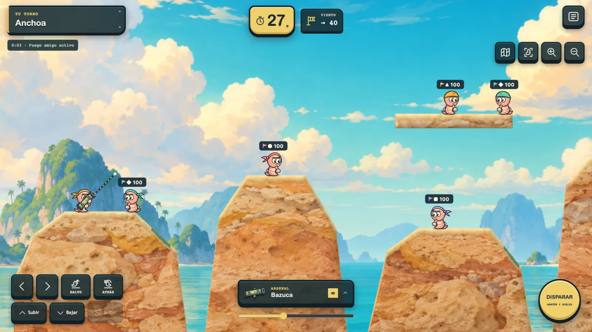
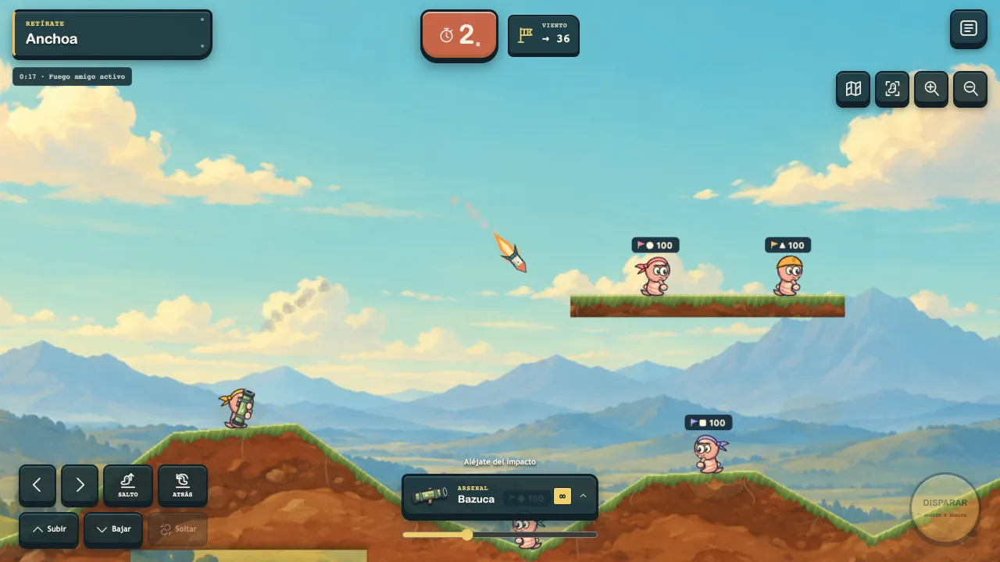
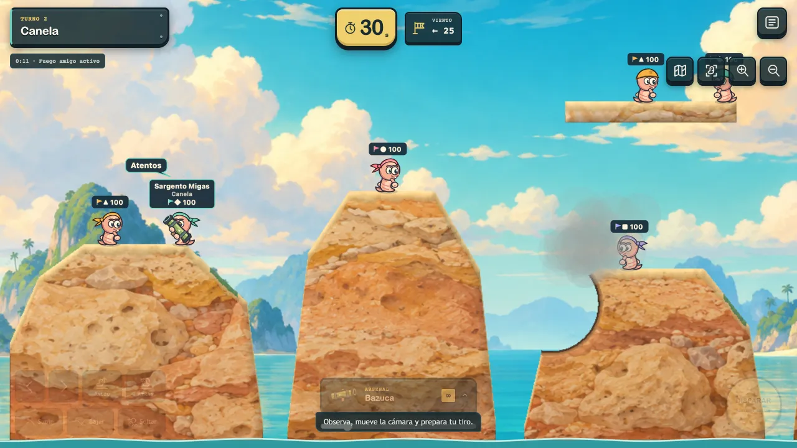
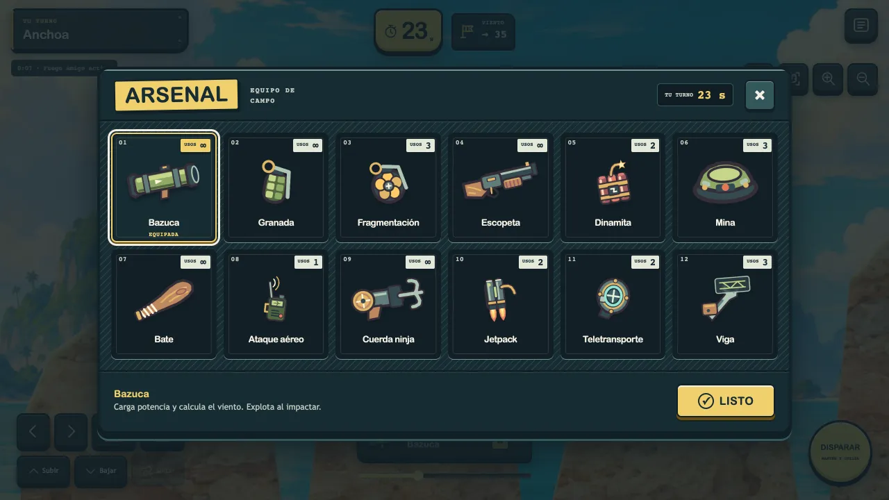
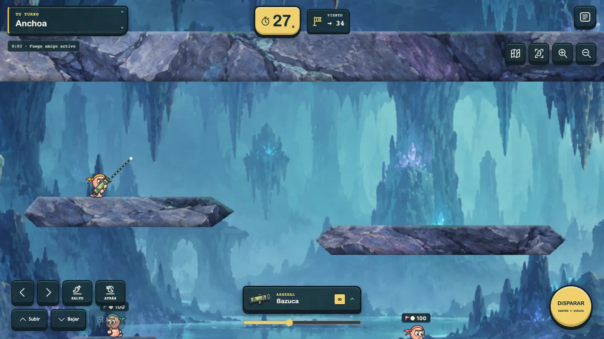
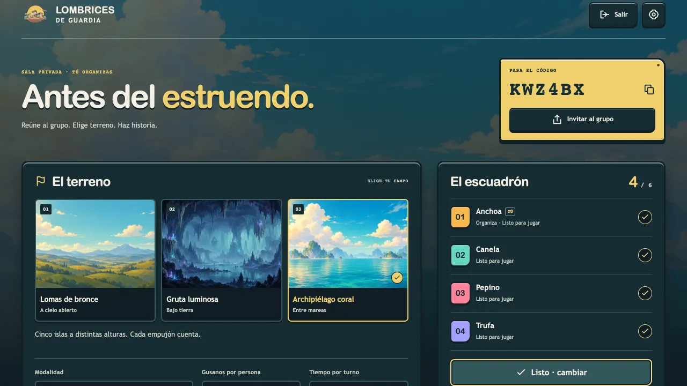
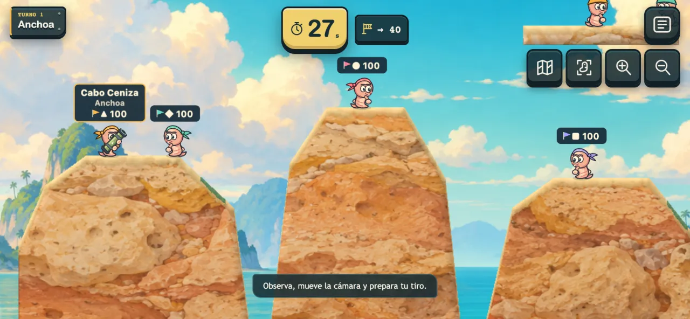

<h1 align="center">Lombrices de guardia</h1>

Lombrices de guardia es un juego de artillería por turnos en el que de 2 a 6 amigos se
enfrentan con pelotones de gusanos armados hasta los dientes. Hay que calcular cada disparo
contra el viento, las explosiones le arrancan pedazos al mapa y, si te descuidas, tu propio
gusano termina en el agua.

Cada impacto se siente: la cámara se sacude, el humo tarda en disiparse y el cráter queda
marcado en la roca para el resto de la partida. Los gusanos están animados pieza por pieza,
se encogen al recibir un golpe, gritan «¡Glub!» cuando se hunden y presumen cuando aciertan.
La música es original y sube de tensión cuando al turno le quedan cinco segundos, y cuando cae
el último gusano el golpe final se repite en cámara lenta.

Se juega en el navegador, desde la computadora o el teléfono, sin instalar nada ni crear
cuentas: alguien abre una sala, comparte el código y empieza la partida.

El juego está en español y todavía en beta.



## Qué trae

- 12 armas y herramientas: bazuca, granada, fragmentación, escopeta, dinamita, mina, bate,
  ataque aéreo, cuerda ninja, jetpack, teletransporte y viga.
- 3 mapas: Lomas de bronce, Gruta luminosa y Archipiélago coral.
- Todos contra todos, 2 contra 2, 3 contra 3 o tres equipos de dos.
- De 2 a 4 gusanos por jugador y turnos de 30, 45 o 60 segundos.
- Cajas de suministros que bajan en paracaídas con vida o munición.
- Muerte súbita: a los diez minutos el agua empieza a subir.
- Fuego amigo activo. Si empujas a un rival al agua, la baja es tuya.

## Detalles

- Los gusanos respiran, parpadean y siguen la mira con los ojos mientras apuntas. Cada
  jugador lleva dos estilos, bandana o casco, para distinguir a sus gusanos de un vistazo.
- 72 apodos propios (Doña Pólvora, Tito Mecha, Capitana Barro…) y frases que cambian según
  lo que les pasa.
- La cámara sigue el proyectil y, cuando una granada de fragmentación se reparte por el mapa,
  se aleja sola para que veas todos los pedazos.
- Mapas pintados con fondos en tres capas de paralaje. Los cráteres muestran lo que hay
  debajo: tierra quemada en las lomas, roca fría en la gruta.
- Las vigas que construyes son de metal, con remaches, y siguen viéndose así aunque una
  explosión les arranque un pedazo.
- Cuerda ninja con balanceo y jetpack con vuelo analógico. Después de moverte todavía puedes
  atacar.
- Un tema de marimba original y efectos distintos para cada arma, todo sintetizado en el
  navegador. No hay un solo archivo de audio en el repositorio.
- Repetición en cámara lenta del golpe final y un resumen con el mejor tiro, el disparo más
  largo y el jugador de la partida.

## En el teléfono

- Dos palancas táctiles, o apunta arrastrando desde tu gusano como si fuera una honda.
- Tu gusano responde al instante aunque haya lag: el teléfono predice su movimiento mientras
  llega la respuesta del servidor.
- Se puede instalar en la pantalla de inicio del iPhone.
- Modo zurdo, sensibilidad ajustable y calidad gráfica automática para teléfonos lentos.

## Capturas

|                                                                                    |                                                                   |
| ---------------------------------------------------------------------------------- | ----------------------------------------------------------------- |
|  |  |
|                                           |                     |
|                                       |             |

## Jugar en local

Necesitas Node.js 22.13 o posterior (rama 22) o Node.js 24 o posterior.

```sh
git clone <url-del-repositorio>
cd lombrices-de-guardia
npm ci
npm run dev
```

Abre http://localhost:3000. Para simular varios jugadores en la misma computadora, abre cada
uno en una ventana privada o en otro perfil del navegador.

Para jugar con otros dispositivos de tu red:

```sh
HOST=0.0.0.0 npm run dev
```

Y abre `http://<ip-de-tu-computadora>:3000` en cada uno.

## Controles

| Acción               | Teclado          | Pantalla táctil             |
| -------------------- | ---------------- | --------------------------- |
| Moverse              | A/D o ←/→        | Palanca izquierda           |
| Apuntar              | ↑/↓              | Palanca derecha o arrastrar |
| Saltar / hacia atrás | Enter / Shift    | Botones de salto            |
| Disparar             | Mantener Espacio | Mantener Disparar           |
| Arsenal              | E                | Botón del arma              |
| Centrar cámara       | C                | Botón de centrar            |

La lista completa, incluidas la cuerda y el jetpack, está en [docs/PLAYING.md](docs/PLAYING.md).

## Servidor

```sh
npm ci
npm run build
npm start
```

También hay un [Dockerfile](Dockerfile). Las salas viven en memoria, así que debe correr una
sola instancia y un reinicio termina las partidas en curso. Para publicarlo detrás de un proxy
con HTTPS, revisa [docs/DEPLOYMENT.md](docs/DEPLOYMENT.md).

## Cómo está hecho

- El servidor simula la partida y decide todo: posiciones, daño, viento y turnos. El navegador
  solo envía lo que quieres hacer, así que no se puede hacer trampa desde el cliente.
- JavaScript sin framework, con Canvas 2D y [PixiJS](https://pixijs.com/). En producción solo
  depende de `pixi.js` y `ws`.
- Si se cae la conexión, vuelves a la misma partida en el mismo turno.
- Menús navegables con teclado, etiquetas para lectores de pantalla y una opción para reducir
  el movimiento.
- 169 pruebas automáticas, más partidas completas que se juegan solas en Chromium y WebKit en
  los tres mapas en cada push.

La estructura del código y el protocolo están en [docs/ARCHITECTURE.md](docs/ARCHITECTURE.md).

## Documentación

- [PLAYING](docs/PLAYING.md): controles, juego desde teléfonos y reconexión.
- [RULES](docs/RULES.md): reglas, turnos y balance de las armas.
- [ARCHITECTURE](docs/ARCHITECTURE.md): estructura del código y protocolo.
- [DEPLOYMENT](docs/DEPLOYMENT.md): configuración y despliegue.
- [TESTING](docs/TESTING.md): pruebas automáticas y manuales.
- [ASSETS](docs/ASSETS.md): origen y licencias de los recursos.

## Contribuir

Los reportes de errores y los pull requests son bienvenidos. Antes de abrir uno, ejecuta
`npm run verify` y revisa [CONTRIBUTING.md](CONTRIBUTING.md). Para reportar una vulnerabilidad,
sigue [SECURITY.md](SECURITY.md).

## Licencia

El código y los recursos del juego se distribuyen bajo la [licencia MIT](LICENSE). Las
dependencias mantienen sus propias licencias; ver [THIRD_PARTY_NOTICES.md](THIRD_PARTY_NOTICES.md).

Los fondos y texturas de los mapas se generaron con una herramienta de generación de imágenes;
los prompts están en [docs/ART-PROMPTS.md](docs/ART-PROMPTS.md). El resto del arte es vectorial
y está hecho en código.

Este proyecto no está afiliado a Team17 ni a la serie Worms.
